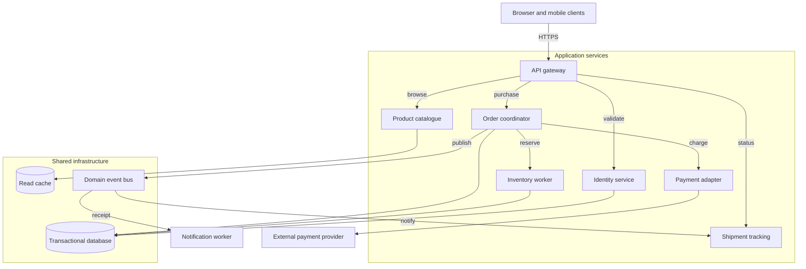
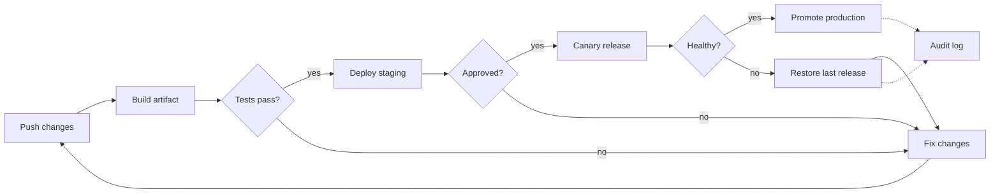
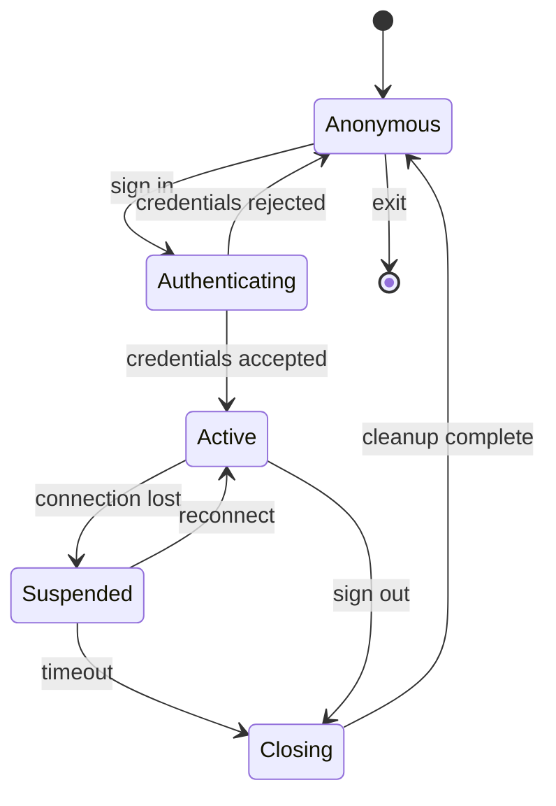
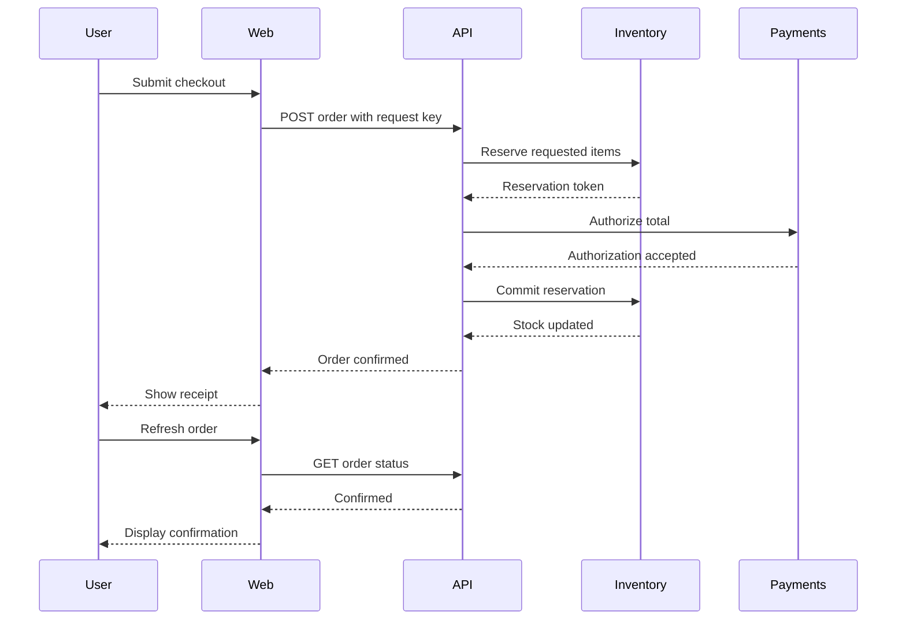
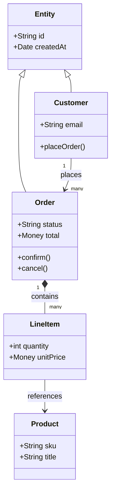
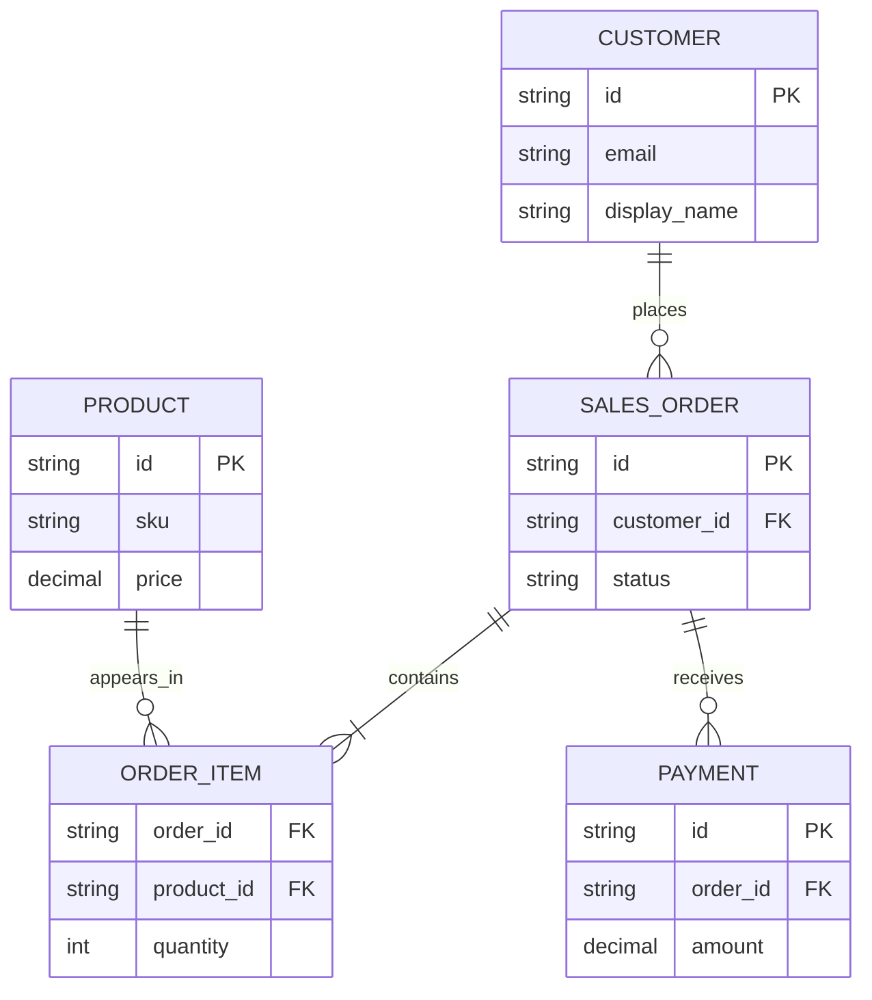
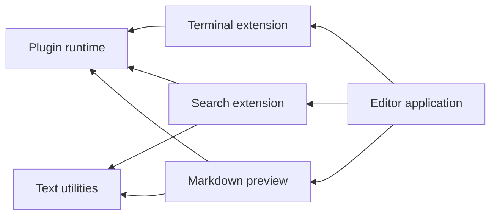
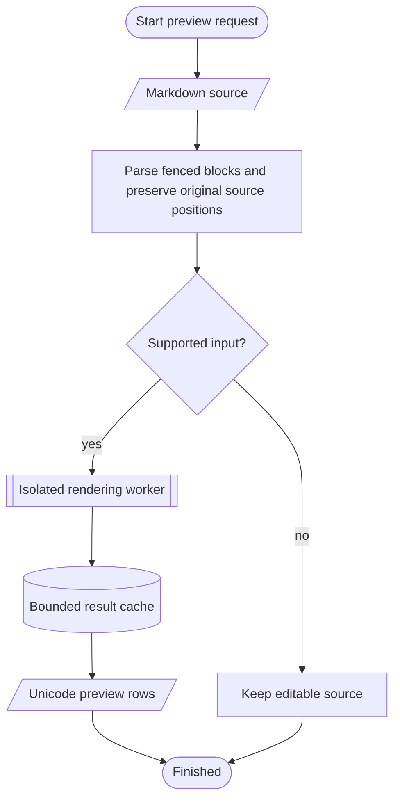

# Advanced Markdown and Mermaid preview

Open this file in Fresh and run **Markdown: Toggle Compose/Preview**. Use
**Set Compose Width → None** for the full pane. Wide graphs keep their topology:
use **Markdown: Pan Diagrams Left**, **Right**, and **Center** to explore them.

This is an integration showcase, not a promise of complete Mermaid.js parity.
The diagrams below exercise our bundled renderer; colors and HTML styling are
intentionally absent from the terminal preview. Toggle back to source to edit.

## Coverage checklist

| Example | What to inspect |
| --- | --- |
| Delivery platform | Groups, fan-out, fan-in, labeled links, shared dependencies |
| Deployment pipeline | Decisions, failure paths, backward links, dotted links |
| Session lifecycle | Initial/final states, cycles, branching transitions |
| Checkout sequence | Participants, requests, replies, repeated interactions |
| Domain model | Inheritance, composition, associations, member lists |
| Relational model | Cardinalities, relationship labels, entity attributes |
| Reverse dependency graph | Right-to-left direction, converging dependencies |
| Shape catalogue | Alternative node shapes and long labels |

## 1. Delivery platform

Follow an incoming request through the gateway to several services. Notice that
multiple services share the database and event bus; these must remain single
nodes rather than being duplicated into separate panels.



**After the diagram:** this paragraph should stay visible and wrap normally,
even when the diagram extends beyond the pane.

## 2. Deployment pipeline with recovery

Both rejection and rollback return to earlier stages. Dotted notification edges
should remain distinct from the main deployment path.



## 3. Session lifecycle

Expiration and explicit sign-out converge on cleanup. A disconnected session can
resume without creating another authenticated session.



## 4. Checkout sequence

The same participants communicate several times. Request and response arrows
should preserve their direction and their message text.



## 5. Domain model

Inspect arrow endpoints as well as the class member text. A text renderer may
approximate UML decorations, but each relationship should remain represented.



## 6. Relational model

Entities have multiple attributes, and the join entity connects orders to
products. Check that relationship labels survive the compact layout.



## 7. Reverse dependency graph

This graph deliberately reads from right to left. The shared runtime must have
three incoming links, while the utilities node has two.



## 8. Shape catalogue and label wrapping

Inspect recognizable shapes and readable labels. The long processing label
should wrap inside its node rather than causing the surrounding prose to wrap
as diagram content.



## Markdown around diagrams

### Normal formatting

- **Bold**, *italic*, and `inline code` should still work.
- [Local basic example](mermaid.md) should remain a normal Markdown link.
- Diagrams above must not consume this list or the following code block.

> Preview output is derived from the source. Toggle compose off to inspect or
> edit the original Mermaid without losing its formatting.

```typescript
const example = { language: 'mermaid', mode: 'preview' };
console.log(example);
```

### Intentional failure fallback

This final block is deliberately invalid. It should stay visible as source,
without freezing the editor or affecting the valid diagrams above.

```mermaid
this is deliberately not a Mermaid diagram
```

**End of showcase.** This sentence should remain visible after the failed block.
