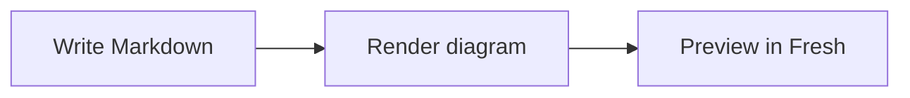
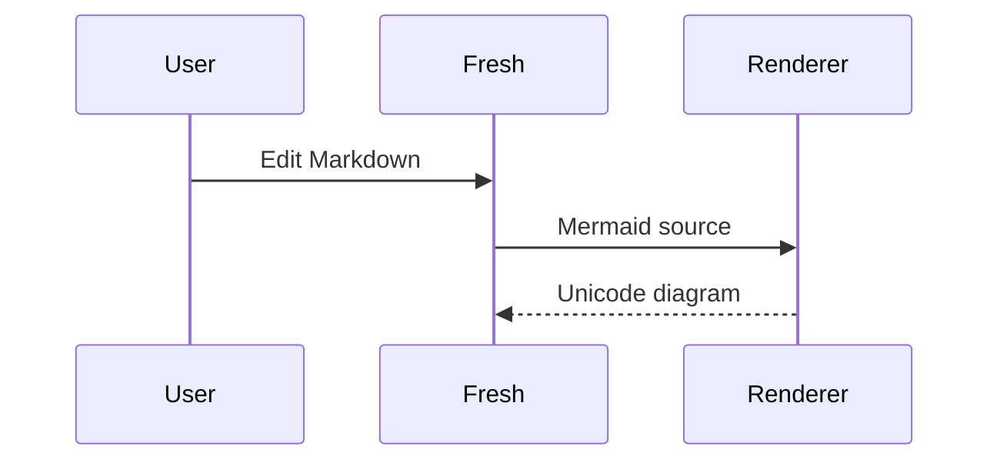

# Mermaid preview smoke test

Use **Markdown: Toggle Compose/Preview**. Text before and after each diagram should
remain visible. Editing a label in the source pane should update the diagram.
For a larger showcase, open [the advanced example](advanced.md).
## Flowchart



This paragraph should appear below the flowchart.

## Sequence



This paragraph should appear below the sequence.

## Failed input stays editable

```mermaid
not a valid diagram
```

## Ordinary code is unchanged

```typescript
const message = 'Hello, Fresh';
```
